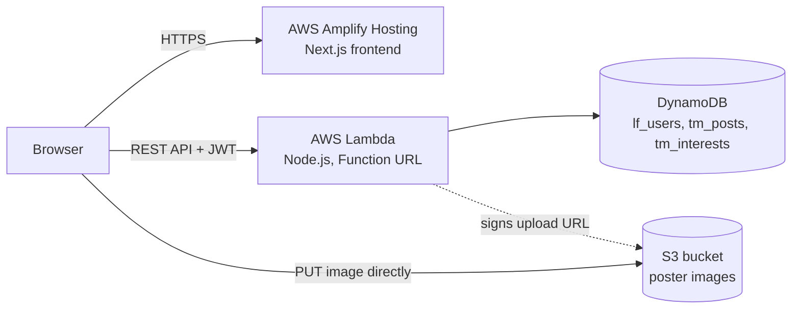

# HackMates: Find your hackathon dream team

HackMates is a full-stack, serverless web app where students post the hackathon they are entering, list the skills they need, and let interested people reach out. People who want to join press **"I'm In"** and leave their contact details, which only the post owner can see.

**Live demo:** https://main.d3mmdtviy3bepk.amplifyapp.com

> Tip for reviewers: registration needs no email verification. Create two accounts (one in a normal window, one in incognito) to see the full "post, show interest, view contacts" flow.

---

## Features

- **Register / login** with email and password (JWT based, 7-day sessions)
- **Explore feed** that is public, with search by hackathon name and filtering by skill, plus an "Open only" toggle
- **Create a post:** hackathon name, description, required skills (up to 8), number of teammates needed, optional poster image
- **Show interest:** a logged-in user shares a contact (WhatsApp, LinkedIn, GitHub...) and a short message; one request per user per post
- **My Profile:** your posts, live stats, and the list of interested people with their contact details
- **Manage posts:** close, reopen or delete your own posts
- **Logout and delete account:** account deletion needs the password and also removes your posts and every interest connected to them
- **Responsive UI** that works from 320px phones to desktops, with loading skeletons, empty states and error messages

## Architecture



| Layer | Technology |
|---|---|
| Frontend | Next.js (App Router), React, Tailwind CSS |
| Hosting | AWS Amplify Hosting, auto-deploys on every push to `main` |
| API | One AWS Lambda function (Node.js) exposed through a Lambda Function URL |
| Database | Amazon DynamoDB (on-demand capacity) |
| File storage | Amazon S3, with presigned upload URLs |
| Auth | `bcryptjs` password hashing and `jsonwebtoken` (JWT) |

**No EC2 is used anywhere.** The backend is fully serverless.

## Project structure

```
HackMates/
├── amplify.yml            # Amplify build settings (monorepo: appRoot = frontend)
├── backend/
│   ├── index.js           # the whole Lambda handler (routing, auth, DynamoDB, S3)
│   └── package.json
└── frontend/
    └── app/
        ├── page.js        # single-page app shell (feed, auth, new post, profile views)
        ├── layout.js
        ├── globals.css
        ├── lib/api.js     # fetch wrapper, image compression, S3 upload helper
        └── components/    # Navbar, AuthForm, PostCard, PostForm, Profile, MyPosts, InterestModal
```

## API reference

Base URL is the Lambda Function URL. Protected routes need the header `Authorization: Bearer <token>`.

| Method | Route | Auth | Description |
|---|---|---|---|
| POST | `/register` | public | Create an account (`name`, `email`, `password` of at least 6 characters) |
| POST | `/login` | public | Returns a JWT and the user |
| GET | `/posts` | public | List all posts, newest first |
| POST | `/posts` | user | Create a post |
| POST | `/upload-url` | user | Get a presigned S3 URL for a poster image (jpeg, png or webp) |
| POST | `/posts/{id}/interest` | user | Show interest in someone else's open post |
| GET | `/posts/{id}/interests` | owner | See who is interested, with their contacts |
| PATCH | `/posts/{id}` | owner | Close or reopen a post (`{ "status": "closed" }`) |
| DELETE | `/posts/{id}` | owner | Delete a post and its interests |
| DELETE | `/me` | user | Delete your account (needs `password`) and all related data |

## Data model (DynamoDB)

| Table | Key | Main attributes |
|---|---|---|
| `lf_users` | `email` (partition) | `name`, `passwordHash`, `createdAt` |
| `tm_posts` | `id` (partition) | `hackathon`, `description`, `skills[]`, `teamSize`, `imageUrl`, `status`, `interestCount`, `ownerEmail`, `ownerName`, `createdAt` |
| `tm_interests` | `postId` (partition) + `userEmail` (sort) | `name`, `contact`, `message`, `createdAt` |

The composite key on `tm_interests` is deliberate: it stops one user from showing interest twice (enforced with a conditional write) and lets the owner fetch all interests of a post with a single efficient `Query` instead of a table scan.

## Performance choices

- Poster images are **resized and compressed in the browser** (max 1000px wide, JPEG 80%) before upload
- Images **upload straight to S3** through a presigned URL, so the file never passes through Lambda
- Images are **lazy loaded**, and the feed shows **skeleton placeholders** while data loads
- Lightweight frontend with no heavy UI libraries; Tailwind styles plus a small custom CSS file
- Interests are read with a DynamoDB `Query` on the partition key, and tables use on-demand capacity
- Frontend is served through Amplify Hosting's CDN

## Security notes

- Passwords are hashed with bcrypt and never returned by the API
- Every protected route verifies the JWT, and owner-only actions compare the post's `ownerEmail` with the token
- Contact details are only visible to the post owner
- Upload URLs expire after 5 minutes, accept only jpeg/png/webp, and post creation rejects image URLs that are not from the project's bucket
- Secrets (`JWT_SECRET`) live in Lambda environment variables, not in the repository
- Deleting an account requires re-entering the password

## Run it yourself

### 1. AWS resources (region `ap-south-1`)

1. **DynamoDB:** create three on-demand tables: `lf_users` (key `email`), `tm_posts` (key `id`), `tm_interests` (partition key `postId`, sort key `userEmail`). All keys are strings.
2. **S3:** create a bucket for posters. Allow public read on `uploads/*` only (bucket policy) and add a CORS rule allowing `PUT` and `GET`.
3. **Lambda:** create a Node.js function, then from `backend/` run `npm install` and upload a zip of `index.js`, `package.json` and `node_modules`. Set these environment variables:

   | Variable | Value |
   |---|---|
   | `USERS_TABLE` | `lf_users` |
   | `POSTS_TABLE` | `tm_posts` |
   | `INTERESTS_TABLE` | `tm_interests` |
   | `PHOTO_BUCKET` | your bucket name |
   | `JWT_SECRET` | a long random string |

4. **IAM:** give the Lambda role `dynamodb:GetItem/PutItem/UpdateItem/DeleteItem/Scan/Query` on the three tables and `s3:PutObject` on `uploads/*` of the bucket.
5. **Function URL:** enable it with auth type `NONE` and CORS allowing the `content-type` and `authorization` headers.

### 2. Frontend

```bash
cd frontend
npm install
```

Create `frontend/.env.local` (no trailing slash):

```
NEXT_PUBLIC_API_URL=https://<your-function-url>.lambda-url.ap-south-1.on.aws
```

```bash
npm run dev      # http://localhost:3000
npm run build    # production build
```

### 3. Deploy

The repo is connected to **AWS Amplify Hosting** as a monorepo (`appRoot: frontend`, see `amplify.yml`). Set `NEXT_PUBLIC_API_URL` in the Amplify environment variables; every push to `main` triggers a new build and deployment. The Lambda backend is deployed separately by uploading the zip.

## Known limitations and next steps

- `GET /posts` uses a table `Scan`. That is fine at this scale, but a larger deployment would add pagination or a Global Secondary Index
- The JWT is stored in `localStorage`; an `httpOnly` cookie would be safer for production
- No email verification, password reset or rate limiting yet
- `interestCount` is kept in sync with separate writes (it could drift if a write fails midway); a DynamoDB transaction would make it atomic
- A "who I showed interest in" view for applicants is not built yet

## About

Built as a submission for a serverless web app assessment: Next.js frontend with an AWS backend (Lambda, DynamoDB, S3, no EC2). Developed with AI-assisted tools, as permitted by the assessment brief.

**Author:** Aditya